# Day 4: Pods

*This is a living file. We update it as we learn. We correct old parts and do not only add to the end.*
*Last updated: 2026-10-14*

> [!NOTE]
> The diagrams use **Mermaid**. GitHub shows them as pictures.
> In VS Code, install the extension **"Markdown Preview Mermaid Support"**, then open the preview (`Ctrl+Shift+V`).

## Contents

1. [Goal](#1-goal)
2. [The hierarchy: cluster, node, pod, container](#2-the-hierarchy-cluster-node-pod-container)
3. [Where is the image?](#3-where-is-the-image)
4. [Our lab architecture](#4-our-lab-architecture)
5. [Inside the cluster: the parts and their jobs](#5-inside-the-cluster-the-parts-and-their-jobs)
6. [What happens when you run `kubectl run`](#6-what-happens-when-you-run-kubectl-run)
7. [The declarative method: a pod from a YAML file](#7-the-declarative-method-a-pod-from-a-yaml-file)
8. [Pod status: the life of a pod](#8-pod-status-the-life-of-a-pod)
9. [Real-life projects: how big systems look](#9-real-life-projects-how-big-systems-look)
10. [What does NOT work (summary)](#10-what-does-not-work-summary)
11. [Problems we had and the fixes](#11-problems-we-had-and-the-fixes)
12. [Command reference (word by word)](#12-command-reference-word-by-word)

---

## 1. Goal

Make a pod in two ways: first with the **imperative** method, then with the **declarative** method. Both worked. ✔

| Method | How | Example | Used for |
| --- | --- | --- | --- |
| **Imperative** | You type one command. Kubernetes does it now. | `kubectl run todo-pod ...` | Learning, quick tests, fixing problems |
| **Declarative** | You write a YAML file. Kubernetes makes the cluster match the file. | `kubectl apply -f pod.yaml` | Real projects (the file goes into Git) |

The tutorial uses the `nginx` image. We use **our own todo app image** (`todo:multistage`).
This is closer to real work. Teams run their own apps, not only public images.

> [!TIP]
> **Remember:** Imperative = "do this now". Declarative = "this is how it must be". Real teams use declarative, because Git then records every change.

---

## 2. The hierarchy: cluster, node, pod, container

A cluster contains nodes. A node contains pods. A pod contains one or more containers.

An **image is not a level** in this hierarchy. An image is a **template** (read-only).
Kubernetes uses the template to make a **container** (a running copy).

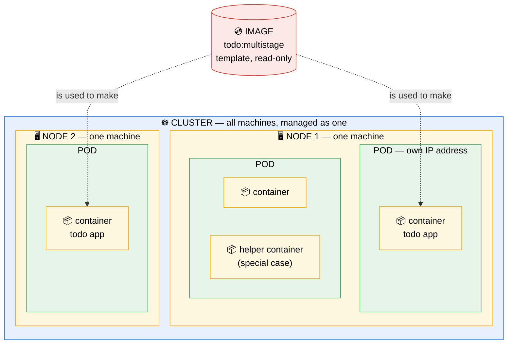

### Each level in detail

| Level | What it is | In our lab | In a real project |
| --- | --- | --- | --- |
| **Cluster** | A group of machines that work as one system. You talk to the cluster, not to each machine. | `kind-cluster-practice` | `prod-cluster` on AWS, with many machines |
| **Node** | One machine that runs pods. It can be a real computer, a cloud VM, or (in kind) a Docker container. | 2 Docker containers | 3 to 100s of cloud VMs |
| **Pod** | The smallest unit that Kubernetes manages. A "wrapper" around containers. It gets one IP address. | `todo-pod` | Many copies of each app |
| **Container** | A running app, made from an image. | The Flask todo app | The API, the website, workers |
| **Image** | The template for a container. Files + settings + start command. | `todo:multistage` | `ghcr.io/company/api:v2.3.1` |

### One simple comparison

| Kubernetes word | Compare it to |
| --- | --- |
| Cluster | A company |
| Node | One office building of the company |
| Pod | One desk, with its own phone number (IP address) |
| Container | The worker at the desk |
| Image | The job description. You can hire many workers from one job description. |

### Rules to remember

- Usually **1 pod = 1 container**.
- Containers in the same pod share **one IP address**. They talk to each other on `localhost`.
- A pod lives on **one node only**. It does not move to a different node.
- Kubernetes manages **pods**, not containers. You never tell Kubernetes "start a container". You tell it "make a pod".

### What does NOT work: wrong ideas about the hierarchy

| Wrong idea | Why it is wrong |
| --- | --- |
| "The image is inside the pod." | The pod runs a **container**. The image is only the template. One image can make 100 containers. |
| "A pod can be on two nodes." | No. One pod is always on one node. For more copies, you make more pods. |
| "I can start a container directly in Kubernetes." | No. The smallest unit is the pod. Kubernetes puts the container in a pod. |
| "Two containers in one pod can both use port 5000." | No. They share one IP address, so they cannot use the same port. |
| "A pod comes back if I delete it." | No. A plain pod is gone forever. A **Deployment** makes new pods (we learn it later). |

---

## 3. Where is the image?

The image must be on the **node** that runs the pod. It is not enough when it is only on your laptop.

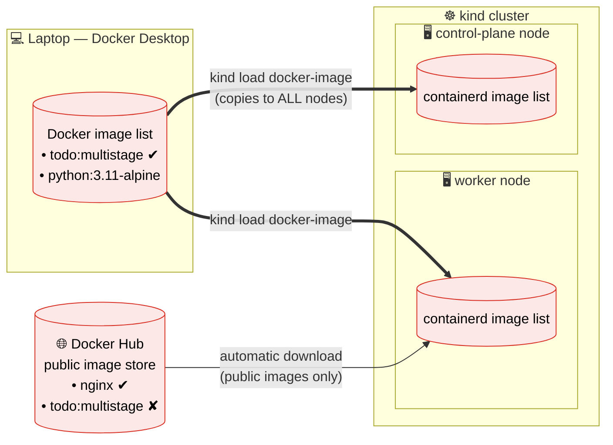

### How it works

- **containerd** is the program inside each node that downloads images and runs containers.
- Each node has its **own** image list. Your laptop's Docker has a **different** image list.
- **Public images** (example: `nginx`): the node downloads them from Docker Hub when it needs them. You do not need to install nginx anywhere.
- **Our own image** is not on Docker Hub. So we copy it into the nodes with `kind load`.
- In real projects, the CI/CD pipeline pushes images to a **registry** (an image store, for example AWS ECR or GitHub GHCR). The nodes download from the registry. Nobody copies images by hand.

### The three places an image can be

An image is stored **on disk** (not in RAM). There are three separate stores. Each store has its **own** copy.

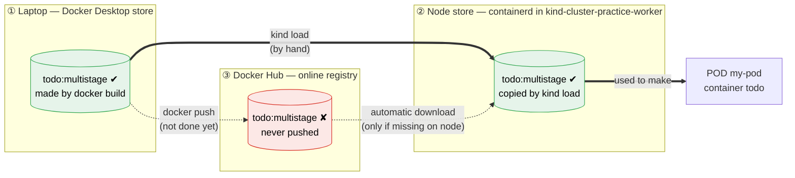

| Store | How the image gets there | Who uses it | Check with |
| --- | --- | --- | --- |
| ① Laptop (Docker Desktop) | `docker build` or `docker pull` | `docker run`, and `kind load` as the source | `docker images` |
| ② Node (containerd) | `kind load`, or automatic download | **Kubernetes. Only this store.** | `docker exec kind-cluster-practice-worker crictl images` |
| ③ Docker Hub (online) | `docker push` | Any computer with internet | The Docker Hub website |

**Important:** the pod uses **only store ②**. It never looks at store ①.

#### When does Docker Hub take part?

Only when the image is **missing on the node** (store ②). Then the node tries to download it.

- An image name with no registry means Docker Hub. `todo:multistage` really means `docker.io/library/todo:multistage`.
- `docker.io/library/` is the place for **official** images (nginx, python). `todo` is not there, so the download fails.
- To use Docker Hub for your own image, put **your username** in the name:

```bash
docker tag todo:multistage hrishikesh26/todo:v1   # give the image a second name
docker login                                       # sign in to Docker Hub
docker push hrishikesh26/todo:v1                   # upload it
```

Then use `image: hrishikesh26/todo:v1` in the YAML. The node downloads it automatically. You do not need `kind load`. This is how real projects work (with a registry).

#### What happens when an image is deleted

| You delete the image from... | A pod that runs now | A new pod |
| --- | --- | --- |
| ① Laptop (`docker rmi todo:multistage`) | Continues to run | ✔ Works. The node has its own copy. (But you cannot `kind load` again until you rebuild.) |
| ② Node (or you delete and make the cluster again) | Continues to run (the container is already made) | ✘ `ErrImagePull`. Docker Hub does not have it. |
| ① and ②, but it is on Docker Hub with your username | Continues to run | ✔ Works. The node downloads it again. |

#### Our real result: the two stores

```text
$ docker images                                        ← ① laptop store
REPOSITORY     TAG          IMAGE ID       SIZE
todo           multistage   d81408ccad1d   89.8MB
kindest/node   <none>       24f646398ba8   938MB       ← the image that kind uses for each NODE

$ docker exec kind-cluster-practice-worker crictl images     ← ② worker node store
IMAGE                                   TAG          IMAGE ID        SIZE
docker.io/library/todo                  multistage   d81408ccad1da   94.5MB   ← our app (from kind load)
docker.io/kindest/kindnetd              v2026...     4626fe10df5b9   39.7MB   ← pod network
registry.k8s.io/kube-proxy              v1.37.0      d6a28daf3e6b0   82.8MB   ← network rules
registry.k8s.io/coredns/coredns         v1.14.6      520212b8b0fcd   23.8MB   ← DNS (names to IPs)
registry.k8s.io/kube-apiserver          v1.37.0      ...             104MB    ← control plane parts
registry.k8s.io/etcd                    3.7.0-0      ...             22.3MB   ←   "
registry.k8s.io/kube-scheduler          v1.37.0      ...             62.7MB   ←   "
registry.k8s.io/pause                   3.10         873ed75102791   320kB    ← holds each pod's network
```

What this shows:

- **The same image ID** (`d81408ccad1d...`) in both stores. `kind load` copied the same image. It did not build a new one.
- **The full name** in the node is `docker.io/library/todo`. This proves that a short name means "Docker Hub, official area".
- **The size is different** (89.8 MB and 94.5 MB). Docker and containerd measure in different ways. It is the same image.
- **Kubernetes itself runs from images.** The API server, etcd, scheduler and kube-proxy are also containers. They come from `registry.k8s.io` (the Kubernetes project's registry).
- **`pause`** is a very small container in **every** pod. It holds the pod's IP address. The app containers join it. That is how containers in one pod share one IP.

> [!TIP]
> **Remember:** a registry (Docker Hub, ECR, GHCR) is the **backup and the delivery service** for images. Without a registry, your image lives only on your laptop and on the nodes where you copied it.

### The `:latest` tag and the pull policy

The **pull policy** tells the node when to download an image.

| Tag you use | Pull policy (default) | What the node does | Result in our lab |
| --- | --- | --- | --- |
| `:latest` (or no tag) | `Always` | Always tries to download from the internet | ✘ `ErrImagePull`. Our image is not online. |
| `:multistage`, `:v1`, ... | `IfNotPresent` | Uses the local copy. Downloads only if it is missing. | ✔ Works, after `kind load` |

> [!TIP]
> **Remember:** Do not use `:latest`. With a fixed tag, you always know which version runs. Real teams use tags like `v1.4.2` or the Git commit ID.

### What does NOT work: images
s
| Mistake | What happens |
| --- | --- |
| Build the image, but forget `kind load` | Pod status `ErrImagePull`, then `ImagePullBackOff` |
| Use `docker compose down` to delete an image | It does not delete images. It stops and removes the **containers and networks** that Docker Compose made. (Images only with `--rmi all`.) We do not use Docker Compose here. |
| Think "the image must be running" | An image never runs. It is a stored file. Only containers run. |
| Rebuild the image with the **same tag**, but do not `kind load` again | The pod still runs the **old** version. The node keeps its old copy. |
| Use `:latest` for a local image | The node tries the internet and fails |
| `kind load` while one node is stopped | `kind load` fails (see [Problem 1](#problem-1-kind-load-failed)) |
| Type the image name wrong (`todo:multistag`) | `ErrImagePull`. Kubernetes does not check the name before it makes the pod. |

---

## 4. Our lab architecture

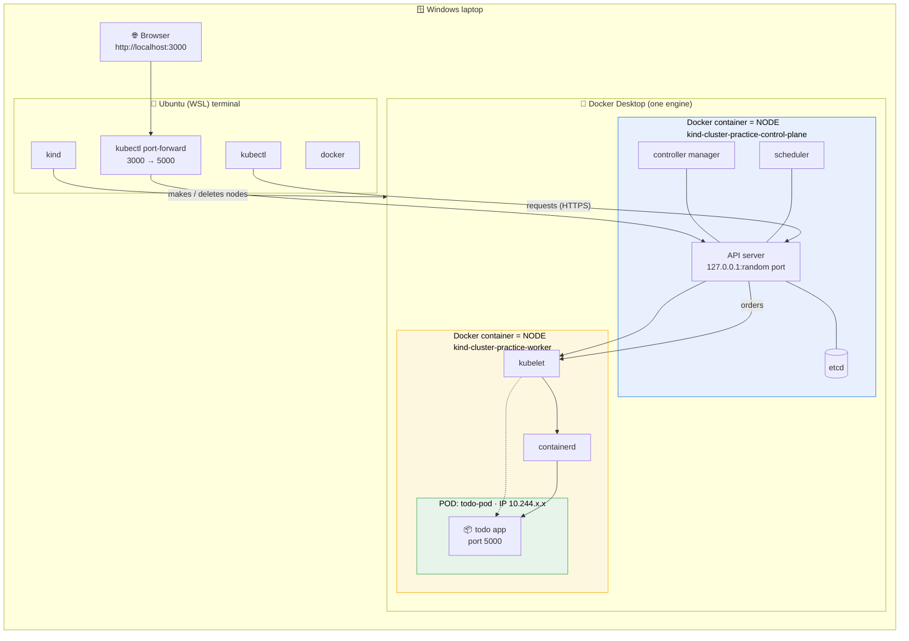

### How to read it

- **In kind, each node is a Docker container.** That is why `docker ps` shows the nodes.
- **The control plane is "the brain".** It decides. Normal pods do not run on it.
- **The worker is "the muscle".** Our pod runs here.
- `kubectl` never talks to the worker directly. It **always** talks to the API server.
- `port-forward` also goes **through** the API server to the pod. That is why it is only for testing.
- The pod IP (`10.244.x.x`) works **inside** the cluster only. Your browser cannot open it.
- Our config now has **1 control plane + 1 worker** (to use less RAM).

### What does NOT work: lab network and nodes

| Mistake | What happens |
| --- | --- |
| Open `http://localhost:5000` without port-forward | Nothing answers. The pod port is inside the cluster, not on your laptop. |
| Open the pod IP `10.244.x.x` in the browser | Nothing answers. That network exists inside the cluster only. |
| Stop a node container in Docker Desktop | Kubernetes shows that node as `NotReady`. Its pods stop. |
| Edit `kind-multinode.yaml` and expect the cluster to change | Nothing changes. kind reads the file **only** at `kind create cluster`. |
| Close the terminal that runs `port-forward` | The tunnel closes. The browser stops working. The pod continues to run. |

---

## 5. Inside the cluster: the parts and their jobs

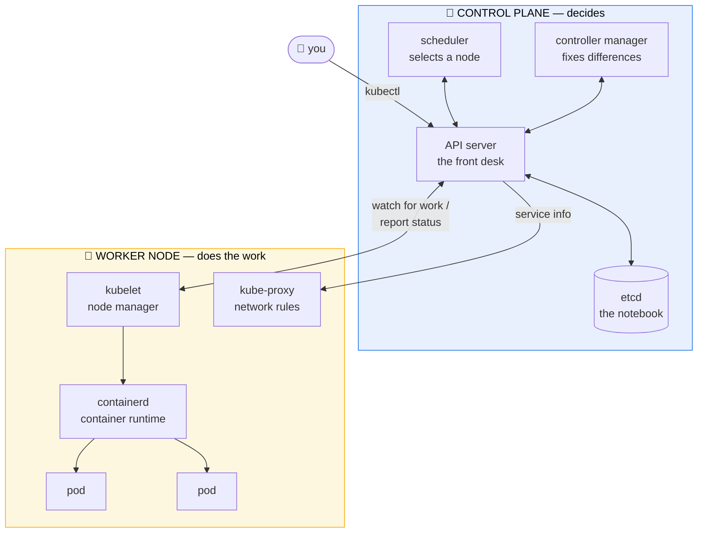

| Part | Where | Job | If it stops |
| --- | --- | --- | --- |
| **API server** | Control plane | Receives **all** requests. It is the only part that talks to etcd. | `kubectl` gets "connection refused". Running pods continue, but nobody can make changes. |
| **etcd** | Control plane | A small database. It stores the full state of the cluster. | The cluster "forgets" everything. That is why real teams make backups of etcd. |
| **Scheduler** | Control plane | Selects a node for each new pod (checks free CPU, RAM, rules). | New pods stay `Pending`. Old pods continue. |
| **Controller manager** | Control plane | Compares "wanted state" with "real state". Fixes the difference. | Nothing repairs itself (example: Deployments do not replace pods). |
| **kubelet** | Each node | Gets work from the API server. Starts and watches the pods on its node. | The node becomes `NotReady`. |
| **containerd** | Each node | Downloads images. Runs containers. | Containers cannot start. |
| **kube-proxy** | Each node | Sets network rules, so traffic for a Service gets to the correct pod. | Services stop sending traffic. (We use Services later.) |

> [!TIP]
> **Remember:** Everything goes through the **API server**. The other parts never talk to each other directly. They all watch the API server.

---

## 6. What happens when you run `kubectl run`

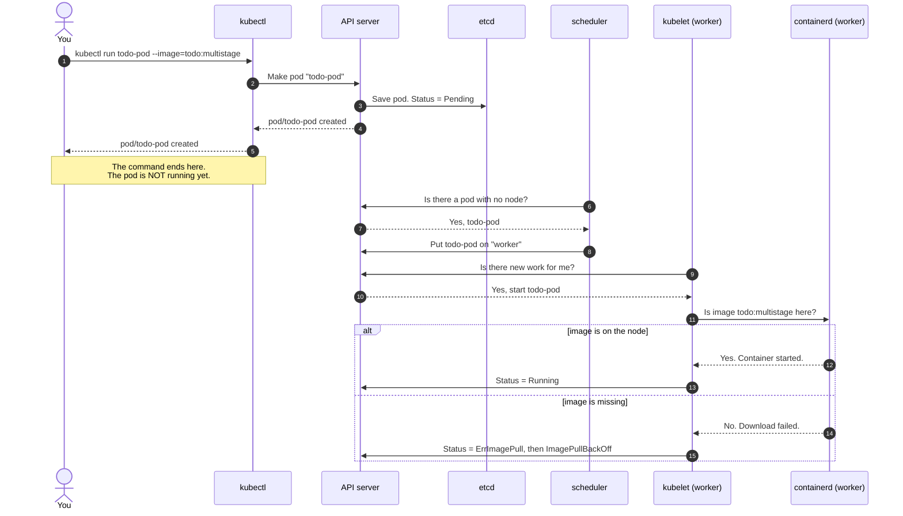

> [!IMPORTANT]
> "`pod/todo-pod created`" does **not** mean "the app runs". It only means "the API server saved your request".
> Always check with `kubectl get pods`.

---

## 7. The declarative method: a pod from a YAML file

With the declarative method, you write the pod in a file. Then you give the file to Kubernetes.
Our file: `Day4-pods-definition/day4-pod.yaml`.

### The four top parts of every Kubernetes YAML file

```yaml
apiVersion: v1            # ① which version of the Kubernetes rules (API) to use
kind: Pod                 # ② which type of object to make
metadata:                 # ③ information ABOUT the object: who is it?
  name: my-pod            #    the name (must be unique in its namespace)
  labels:                 #    name tags that you select. Other objects use them to find this pod.
    env: demo
    type: frontend
spec:                     # ④ the instructions: what must it do?
  containers:             #    the list of containers in the pod
  - name: todo            #    the container's name (inside this pod)
    image: todo:multistage  #  the image to make the container from
    ports:
    - containerPort: 5000 #    the app listens on 5000 (information only)
```

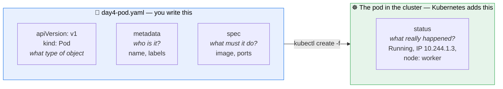

| Part | Who writes it | Simple meaning |
| --- | --- | --- |
| `apiVersion` + `kind` | You | "Make an object of this type." For a pod: `v1` and `Pod`. |
| `metadata` | You | Information **about** the pod: name, labels |
| `spec` | You | The **instructions**: which image, which ports. It is the "wanted state". |
| `status` | **Kubernetes** | What really happened. It is the "real state". See it with `kubectl get pod my-pod -o yaml`. |

> [!TIP]
> **Remember:** You write the **wanted state** (`spec`). Kubernetes writes the **real state** (`status`). Kubernetes always works to make the real state the same as the wanted state.

### `kubectl create` and `kubectl apply`

| Command | If the pod does not exist | If the pod exists |
| --- | --- | --- |
| `kubectl create -f file.yaml` | Makes it | ✘ Error `AlreadyExists` |
| `kubectl apply -f file.yaml` | Makes it | Updates it (only the parts that a pod lets you change) |
| `kubectl delete -f file.yaml` | Error `NotFound` | Deletes it |

`-f` means `--filename`: "read the instructions from this file".

Real teams use `kubectl apply`. They keep the YAML files in Git, so every change has a record.

### Kubernetes does not use the Dockerfile

`image: todo:multistage` is only a **name**. The node looks for that name in its own image store.
Kubernetes never sees the Dockerfile or the project folders.

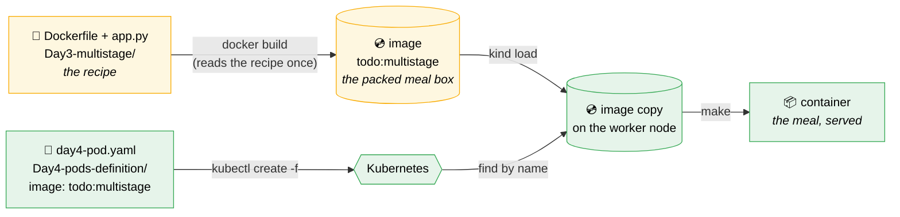

- **Dockerfile** = the recipe. Only `docker build` reads it.
- **Image** = the finished box. Everything is inside it: Python, the app, and the start command.
- **Container** = the running copy, made from the box.
- That is why a YAML file in `Day4-pods-definition/` can use an image made from `Day3-multistage/`. Folders do not matter.
- An image does **not** need to be "running". An image never runs. It is a stored file.

### Our real result

```text
$ kubectl create -f Day4-pods-definition/day4-pod.yaml
pod/my-pod created

$ kubectl get pods -o wide
NAME     READY   STATUS    RESTARTS   AGE   IP           NODE
my-pod   1/1     Running   0          41s   10.244.1.3   kind-cluster-practice-worker

$ kubectl describe pod my-pod     (only the Events part)
Events:
  Normal  Scheduled  default-scheduler  Successfully assigned default/my-pod to kind-cluster-practice-worker
  Normal  Pulled     kubelet            Container image "todo:multistage" already present on machine
  Normal  Created    kubelet            Container created
  Normal  Started    kubelet            Container started
```

How to read the Events (compare with [section 6](#6-what-happens-when-you-run-kubectl-run)):

| Event | Who | Meaning |
| --- | --- | --- |
| `Scheduled` | scheduler | It selected the `worker` node |
| `Pulled` ... `already present on machine` | kubelet | The image was in the node's store (from `kind load`). No download. |
| `Created`, `Started` | kubelet | The container was made and started |

Other useful lines in `describe`:

| Line | Meaning |
| --- | --- |
| `Labels: env=demo, type=frontend` | Your labels from `metadata` |
| `Node: kind-cluster-practice-worker/172.20.0.3` | The node, and the node's own IP address (Docker network) |
| `IP: 10.244.1.3` | The pod's IP address (cluster network, inside only) |
| `Image ID: docker.io/library/import-2026-10-14@sha256:...` | The `import-...` name shows the image came from `kind load`, not from a download |
| `Ready: True`, `Restart Count: 0` | The app runs and did not crash |

### Look inside the running pod: `kubectl exec`

You can open a shell (a command line) **inside** the container. It is like `docker exec`, but through Kubernetes.

```text
$ kubectl exec -it my-pod -- sh
/app $ pwd
/app
/app $ ls -a
.       ..      app.py
/app $ exit
```

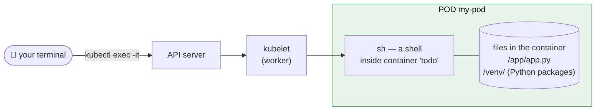

Each result comes from a line in the Dockerfile (`Day3-multistage/Dockerfile`):

| What we saw | Why | Dockerfile line |
| --- | --- | --- |
| The shell starts in `/app` | The working folder of the image | `WORKDIR /app` |
| Only `app.py` is in `/app` | The final stage copies only this one file | `COPY app.py .` |
| No `requirements.txt`, no `Dockerfile` | They stayed in stage 1 (builder). Multi-stage keeps the final image small. | `FROM ... AS builder` |
| The Python packages are not in `/app` | They are in `/venv`, a different folder | `COPY --from=builder /venv /venv` |
| The prompt ends with `$`, not `#` | You are the normal user `appuser`, not `root` (the admin). This is safer. | `USER appuser` |
| The command `sh`, not `bash` | The image is Alpine Linux. Alpine has `sh` only. | `FROM python:3.11-alpine` |

> [!WARNING]
> Changes you make inside a container are **temporary**. If the pod is deleted, they are lost.
> Use `exec` to **look** and to find problems. Do not use it to fix the app. Fix the image instead.

### What does NOT work: YAML files

| Mistake | What happens |
| --- | --- |
| Leave `apiVersion:` or `kind:` empty | Error: `apiVersion not set` / `kind not set`. Nothing is made. |
| Use tabs for indentation | YAML error. YAML accepts **spaces only**. |
| Wrong indentation (example: `image` not under `- name`) | Error, or Kubernetes reads the wrong structure |
| Write `Kind: pod` (wrong capital letters) | Error. Field names and `Pod` are case-sensitive. |
| `kubectl create -f` a second time | Error `AlreadyExists`. Use `kubectl apply -f`, or delete first. |
| Change the `image` in the file, then `kubectl apply` on a running pod | Works for the image only. Most other `spec` fields of a pod cannot change. Then you must delete and create the pod. |
| Change `app.py`, and expect the pod to change | Nothing changes. Rebuild the image, `kind load` it, then make the pod again. |

---

## 8. Pod status: the life of a pod

The `STATUS` column of `kubectl get pods` shows where the pod is in this diagram.

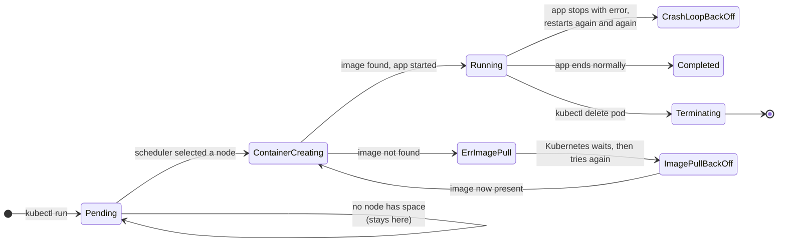

| Status | Meaning | What to do |
| --- | --- | --- |
| `Pending` | Saved, but no node selected yet | `kubectl describe pod <name>` → read "Events" at the bottom |
| `ContainerCreating` | Node selected. Image download or start in progress. | Wait a few seconds |
| `Running` | The container runs | ✔ Good |
| `ErrImagePull` / `ImagePullBackOff` | The node cannot get the image | Check the image name and tag. Do `kind load` again. |
| `CrashLoopBackOff` | The app starts, then stops with an error, again and again | `kubectl logs <name>` → read the app's error |
| `Completed` | The app ended normally (normal for short jobs, not for a web app) | For a web app: check why it stopped |
| `Terminating` | Delete in progress | Wait |

> [!TIP]
> **Remember the 3 debug commands:**
> `kubectl get pods` (what is the status?) → `kubectl describe pod <name>` (why? read Events) → `kubectl logs <name>` (what did the app say?)

---

## 9. Real-life projects: how big systems look

Our lab and a real project use the **same ideas**. A real project has more of each part, plus automation.

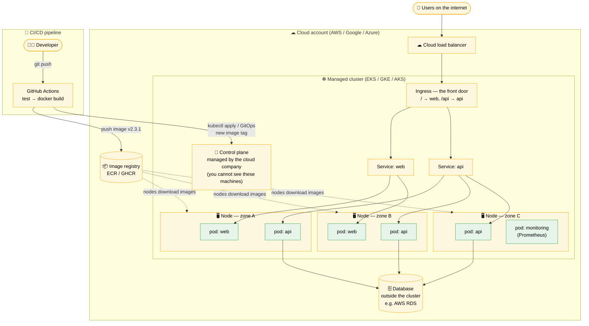

### Why real projects look like this

- **Nodes in different zones** (a zone = a separate data center): if one data center fails, the app continues on the others.
- **Many copies of each pod**: if one pod fails, the others handle the users. A **Deployment** keeps the number of copies correct.
- **Service**: one fixed address for a group of pods. Pods change IP when they restart. The Service does not.
- **Ingress + load balancer**: the only way in from the internet.
- **Database outside the cluster**: pods are temporary. Data must live somewhere permanent.
- **CI/CD**: nobody types `kubectl run` in production. A pipeline builds, tests, and deploys.

### Our lab compared to a real project

| Idea | Our lab | Real project |
| --- | --- | --- |
| Cluster | kind, on one laptop | EKS / GKE / AKS in the cloud |
| Nodes | 2 Docker containers | 3 to 100s of VMs, in different zones |
| Control plane | 1 node, we can see it | Managed by the cloud company |
| How pods are made | `kubectl run` (one pod, by hand) | YAML files in Git + Deployments (many copies) |
| Where images come from | `kind load` from the laptop | A registry (ECR, GHCR, Docker Hub) |
| How you open the app | `kubectl port-forward` | Load balancer → Ingress → Service → pods |
| Where data lives | Inside the pod (lost on delete) | A database outside the cluster |
| Who makes changes | You, by hand | A CI/CD pipeline, automatically |

### What does NOT work in real projects

| Lab habit | Why it fails in production |
| --- | --- |
| `kubectl run` by hand | Nobody knows what changed. There is no record in Git. |
| One plain pod | If it stops, the app is down. Nothing makes a new one. |
| `port-forward` for users | It is a test tunnel from one laptop. It is not for real traffic. |
| `:latest` tag | Different nodes can run different versions. You cannot roll back. |
| Data inside the pod | A pod restart deletes the data. |

> [!TIP]
> **Main point:** A pod in a big company is the same "pod" as ours. The difference is the number of pods and the automation around them.

---

## 10. What does NOT work (summary)

All the "do not do this" points from this file, in one place.

| # | Do not | Because | Do this instead |
| --- | --- | --- | --- |
| 1 | Use `:latest` for a local image | Kubernetes tries to download it from the internet | Use a fixed tag: `todo:multistage`, `todo:v1` |
| 2 | Forget `kind load` after `docker build` | The nodes do not see your laptop's images | `kind load docker-image <image> --name <cluster>` |
| 3 | Stop one node, then `kind load` | `kind load` copies to every node and fails | Start the node again, or use `--nodes`, or make a smaller cluster |
| 4 | Edit the kind YAML to change a running cluster | kind reads it only at create | `kind delete cluster` + `kind create cluster --config ...` |
| 5 | Open `localhost:5000` with no tunnel | The pod port is inside the cluster | `kubectl port-forward pod/<name> 3000:5000` |
| 6 | Trust "`pod created`" | It only means "saved" | Check `kubectl get pods` for `Running` |
| 7 | `kubectl run` with a name that exists | Error: `AlreadyExists` | Delete the old pod first, or use a new name |
| 8 | Expect a deleted pod to come back | Plain pods are not repaired | Use a Deployment (later) |
| 9 | Think `--port=5000` opens the port | It is information only | Use `port-forward` (now) or a Service (later) |
| 10 | Leave `apiVersion` or `kind` empty in YAML | Kubernetes does not know what to make | `apiVersion: v1` and `kind: Pod` |
| 11 | `kubectl create -f` twice | Error `AlreadyExists` | `kubectl apply -f` |
| 12 | Change `app.py` and expect the pod to change | The image is a fixed snapshot | `docker build` → `kind load` → make the pod again |
| 13 | Use `docker compose down` to delete images | It removes containers and networks, not images | `docker rmi <image>` |
| 14 | Expect Docker Hub to have your local image | You never pushed it | `docker tag` + `docker push` with your username |
| 15 | `kubectl exec ... -- bash` in an Alpine image | Alpine has no `bash` | `kubectl exec -it <pod> -- sh` |
| 16 | Fix the app from inside the container with `exec` | Changes are lost when the pod is deleted | Change the code, rebuild the image |

---

## 11. Problems we had and the fixes

### Problem 1: `kind load` failed

```text
ERROR: failed to detect containerd snapshotter: command "docker exec --privileged
kind-cluster-practice-worker2 containerd config dump" failed with error: exit status 1
Error response from daemon: container abc4a7ddb8ee... is not running
```

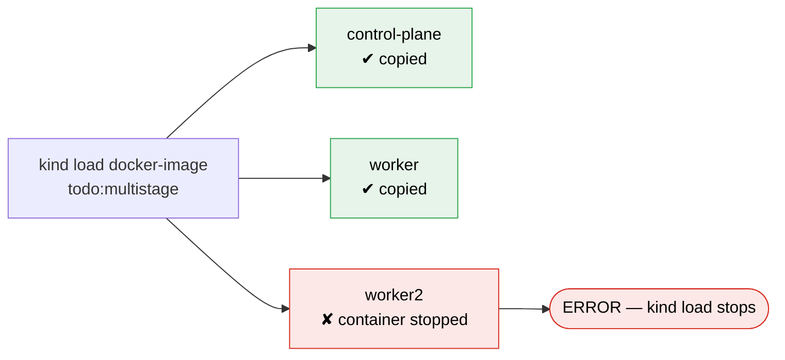

**Cause:** We stopped `worker2` in Docker Desktop to use less RAM.
`kind load` copies the image to **every** node in the cluster.
It cannot copy into a stopped node, so it stops with an error.

**Also:** We changed `kind-multinode.yaml` to remove worker2. This does **not** change the cluster that already exists.

#### Fix A (recommended): make the cluster again with 2 nodes

```bash
kind delete cluster --name kind-cluster-practice
kind create cluster --config Day3-multistage/kind-multinode.yaml
kubectl get nodes                       # 2 nodes, both Ready
kind load docker-image todo:multistage --name kind-cluster-practice
```

#### Fix B (quick): copy the image only into the running node

```bash
kind load docker-image todo:multistage --name kind-cluster-practice \
  --nodes kind-cluster-practice-worker
```

With fix B, `kubectl get nodes` still shows worker2 as `NotReady`.
Kubernetes does not put new pods on a `NotReady` node, so the pod goes to `worker`.

#### What we did

We used fix A (new cluster with 2 nodes). Then we loaded the image with `--nodes kind-cluster-practice-worker`.
Result: the image is on `worker` only, not on `control-plane`. This is OK, because normal pods never run on the control plane.

---

## 12. Command reference (word by word)

### `kind get clusters`

| Word | Meaning |
| --- | --- |
| `kind` | The tool that makes Kubernetes clusters inside Docker ("**K**ubernetes **IN** **D**ocker") |
| `get clusters` | Show the names of all kind clusters |

### `docker ps -a`

| Word | Meaning |
| --- | --- |
| `docker` | The tool that builds images and runs containers |
| `ps` | Show containers ("process status") |
| `-a` | Show **all** containers, also stopped ones. Without it: only running ones |

### `docker build -t todo:multistage Day3-multistage`

| Word | Meaning |
| --- | --- |
| `build` | Make an image from a Dockerfile |
| `-t` | Give the image a name ("**t**ag") |
| `todo:multistage` | `name:tag`. Name = `todo`, tag (version label) = `multistage` |
| `Day3-multistage` | The folder with the Dockerfile and app files (the "build context") |

### `docker images` and `docker rmi todo:multistage`

| Word | Meaning |
| --- | --- |
| `images` | Show all images in the laptop's Docker store |
| `rmi` | Delete an image ("**r**e**m**ove **i**mage"). Same as `docker image rm`. |
| `todo:multistage` | The image to delete. Docker refuses if a container still uses it. |

### `docker exec kind-cluster-practice-worker crictl images`

| Word | Meaning |
| --- | --- |
| `exec` | Run a command inside a running container |
| `kind-cluster-practice-worker` | The container. In kind, this container is the worker node. |
| `crictl images` | A tool inside the node. It shows the images in containerd's store (store ②). |

### `docker tag` and `docker push`

| Word | Meaning |
| --- | --- |
| `tag todo:multistage hrishikesh26/todo:v1` | Give the image a second name. The name starts with your Docker Hub username. |
| `login` | Sign in to Docker Hub (one time) |
| `push hrishikesh26/todo:v1` | Upload the image to Docker Hub |

### `kind load docker-image todo:multistage --name kind-cluster-practice`

| Word | Meaning |
| --- | --- |
| `load docker-image` | Copy an image from your laptop's Docker into the cluster's nodes |
| `todo:multistage` | The image to copy |
| `--name kind-cluster-practice` | Which cluster to copy into |
| `--nodes <node1>,<node2>` | (Optional) Copy only into these nodes. Default: all nodes |

### `kind create cluster --config <file>` and `kind delete cluster --name <name>`

| Word | Meaning |
| --- | --- |
| `create cluster` | Make a new cluster (starts the node containers) |
| `--config <file>` | Use this YAML file for the settings (number of nodes, versions) |
| `delete cluster` | Remove the cluster and its node containers |

### `kubectl get nodes`

| Word | Meaning |
| --- | --- |
| `kubectl` | The tool to talk to a Kubernetes cluster. It sends requests to the API server. |
| `get` | Show a list of objects |
| `nodes` | The type of object: the machines in the cluster |

### `kubectl run todo-pod --image=todo:multistage --port=5000`

| Word | Meaning |
| --- | --- |
| `run` | Make one pod now (the imperative method) |
| `todo-pod` | The name of the new pod. You select the name. |
| `--image=todo:multistage` | The image for the pod's container |
| `--port=5000` | Record that the app listens on port 5000. Information only. It does not open the port to you. |

### `kubectl create -f Day4-pods-definition/day4-pod.yaml`

| Word | Meaning |
| --- | --- |
| `create` | Make a new object. Error if it exists. |
| `-f` | Short for `--filename`: read the instructions from this file |
| `Day4-pods-definition/day4-pod.yaml` | The path to the file, from the folder where you are now |
| `apply` (instead of `create`) | Make it, or update it if it exists |

### `kubectl exec -it my-pod -- sh`

| Word | Meaning |
| --- | --- |
| `exec` | Run a command inside a container of a pod |
| `-i` | "interactive": send your keyboard input to the command |
| `-t` | "tty": give it a real terminal screen (so you see a prompt) |
| `my-pod` | The pod. If it has more than one container, add `-c <container-name>`. |
| `--` | "kubectl options end here". All words after it go to the container. |
| `sh` | The command to run: a shell. Type `exit` to leave. |

### What does NOT work: `kubectl exec`

| Mistake | What happens |
| --- | --- |
| `kubectl exec -it my-pod -- bash` | Error: `bash` not found. Alpine images have `sh` only. |
| Forget `-it` | The shell starts and stops at once. You see no prompt. |
| Forget `--` | Older kubectl versions read `sh` as a kubectl option and give an error |
| `exec` into a pod that is not `Running` | Error. There is no running container to enter. |

### `kubectl get pod my-pod -o yaml`

| Word | Meaning |
| --- | --- |
| `get pod my-pod` | Show one pod |
| `-o yaml` | Show it as YAML: your `spec` plus the `status` that Kubernetes wrote |

### `kubectl get pods -o wide`

| Word | Meaning |
| --- | --- |
| `get pods` | Show all pods |
| `-o wide` | Output format: show more columns (pod IP address, node name) |

### `kubectl describe pod todo-pod`

| Word | Meaning |
| --- | --- |
| `describe` | Show **all** details of one object |
| `pod todo-pod` | The type and the name of the object |
| (output) "Events" | The list at the bottom. It tells you **why** a pod has a problem. |

### `kubectl logs todo-pod`

| Word | Meaning |
| --- | --- |
| `logs` | Show what the app wrote to its output (its messages and errors) |
| `todo-pod` | The pod to read from |
| `-f` | (Optional) "follow": continue to show new lines. Stop with `Ctrl+C`. |

### `kubectl port-forward pod/todo-pod 3000:5000`

| Word | Meaning |
| --- | --- |
| `port-forward` | Make a temporary tunnel from your laptop to the pod |
| `pod/todo-pod` | The target: type `pod`, name `todo-pod` |
| `3000:5000` | `laptop-port:pod-port`. Open `localhost:3000` to reach the app on port 5000. |
| `Ctrl+C` | Stops the tunnel. The pod continues to run. |

### `kubectl delete pod todo-pod`

| Word | Meaning |
| --- | --- |
| `delete` | Remove an object |
| `pod todo-pod` | The type and the name of the object to remove |
